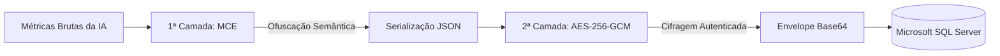

# EmotionLens (Cripto EmotionLens)

Aplicação web para reconhecimento, análise temporal e quantificação de expressões faciais a partir de vídeos, desenvolvida com ênfase em **privacidade e segurança de dados biométricos sensíveis (LGPD)**. Projeto de Trabalho de Conclusão de Curso (TCC) em Ciência da Computação.

O sistema é dividido em dois módulos desacoplados:

- **`frontend/`** — Dashboard interativo em React 18 + Vite, com autenticação JWT, upload de vídeo com feedback de progresso em tempo real, visualização de séries temporais das expressões via Chart.js e histórico de sessões.
- **`backend/`** — API Web RESTful desenvolvida em FastAPI (Python), responsável pela orquestração do pipeline de visão computacional (YOLOv8-face + HSEmotion), pré-processamento adaptativo de imagem, suavização temporal, camada autoral de ofuscação semântica (MCE), criptografia simétrica autenticada (AES-256-GCM) e persistência relacional em Microsoft SQL Server.

---

## Stack Tecnológica

| Camada | Tecnologias / Bibliotecas |
|---|---|
| **Frontend** | React 18, Vite, React Router DOM, Axios, Chart.js, react-chartjs-2, CSS modular |
| **Backend** | FastAPI, Uvicorn, Pydantic v2, PyTorch, Torchvision, Ultralytics (YOLOv8-face), HSEmotion (EfficientNet-B2), OpenCV, PyODBC, Cryptography (AES-256-GCM), PyJWT, Passlib (Bcrypt), Rich |
| **Banco de Dados** | Microsoft SQL Server (driver oficial ODBC via `pyodbc`) |
| **Segurança & Criptografia** | MCE (camada autoral de ofuscação semântica), AES-256-GCM (cifragem autenticada), Bcrypt (hashing de credenciais), JWT Bearer Tokens |

---

## Arquitetura do Backend

O backend foi construído sob uma arquitetura limpa em camadas desacopladas (*Clean/Layered Architecture*), garantindo separação estrita de responsabilidades:

```
backend/app/
  rotas/          Endpoints REST (FastAPI), validação de entrada e injeção de dependências
  servicos/       Regras de negócio, orquestração do pipeline de IA e persistência
  dominio/        Entidades de domínio puras (Usuario, Sessao, Emocao, Midia)
  esquemas/       Contratos de entrada/saída serializados em Pydantic (JSON do frontend)
  persistencia/   Repositórios de dados e gerenciamento de conexões com o SQL Server
  ia/             Pipeline de visão computacional (YOLOv8, HSEmotion, OpenCV, alinhamento, agregação)
  nucleo/         Configurações de ambiente, segurança/criptografia (MCE e AES), logs e exceções
```

**Fluxo de uma Requisição de Análise:**  
`Cliente (React)` ➔ `Roteador FastAPI` ➔ `Serviço de Análise` ➔ `Pipeline de IA` ➔ `Camada de Criptografia (MCE + AES)` ➔ `Repositório (SQL Server)` ➔ `Retorno JSON estruturado`.

---

## Pipeline de Visão Computacional e Inteligência Artificial

O fluxo de processamento de mídia e inferência segue etapas rigorosamente calibradas para equilibrar alta precisão analítica e baixo consumo de recursos:

1. **Validação de Entrada e Trava de Segurança:**  
   A API valida o tipo de arquivo contra formatos suportados (`.mp4`, `.avi`, `.mov`) e impõe limite de tamanho máximo de upload (**200 MB** por padrão), prevenindo ataques de negação de serviço e sobrecarga de memória.
2. **Amostragem Temporal Controlada:**  
   O vídeo não é processado em todos os quadros (o que seria redundante e custoso). Os quadros são amostrados a **10 FPS** (`EMOTIONLENS_FPS_ALVO=10.0`), taxa suficiente para capturar microexpressões faciais com precisão, com teto de até **600 quadros analisados** (~1 minuto de análise contínua).
3. **Detecção Facial e Filtragem de Ruído (YOLOv8-face):**  
   Localização espacial da face utilizando a rede neural convolucional especializada `yolov8n-face.pt`. Quadros sem face detectada, com confiança inferior a **65%** (`confianca_minima_deteccao=0.65`) ou com dimensões menores que **80 pixels** são descartados automaticamente para evitar artefatos e ruídos causados por sombras, mãos ou objetos.
4. **Alinhamento Facial e Expansão Contextual:**  
   A face detectada é rotacionada e alinhada geometricamente pelos centros dos olhos utilizando transformação afim no OpenCV. O recorte facial aplica uma **margem ampliada de 30%** (`margem=0.3`), garantindo que sobrancelhas (fundamentais para detectar Surpresa e Medo) e queixo (essencial para Tristeza) permaneçam no campo de visão do classificador.
5. **Normalização de Iluminação Adaptativa (CLAHE):**  
   Para mitigar webcams de baixa qualidade e ambientes com iluminação deficiente, o recorte é convertido para o espaço de cores **LAB**, onde o canal de luminância (**L**) recebe o algoritmo **CLAHE** (*Contrast Limited Adaptive Histogram Equalization*). O contraste local é normalizado antes da imagem ser repassada em RGB para a rede neural.
6. **Classificação Emocional (HSEmotion):**  
   A inferência das 7 expressões canônicas universais (*Alegria, Tristeza, Raiva, Medo, Surpresa, Nojo e Neutro*) é executada pela rede neural **EfficientNet-B2** pré-treinada do modelo `enet_b2_7`, que gera uma distribuição de probabilidades normalizada via **Softmax**.
7. **Suavização Temporal Anti-Flickering:**  
   Para eliminar oscilações espúrias quadro a quadro decorrentes de piscadas de olhos e movimentação da fala (*flickering*), é aplicado um filtro de **Média Móvel Centrada com janela de 9 quadros** (`janela_suavizacao=9`). Isso estabiliza as séries temporais sem mascarar variações reais de humor.
8. **Descarte Imediato do Vídeo Bruto (Minimização de Dados - LGPD):**  
   Em conformidade estrita com o Art. 6º, inciso III da LGPD, o arquivo de vídeo enviado é alocado em armazenamento temporário apenas durante a leitura dos quadros pelo OpenCV e é **sumariamente excluído do disco no bloco `finally`**. Nenhum arquivo de mídia em vídeo é retido no banco de dados ou no servidor.

---

## Arquitetura de Segurança e Criptografia em Duas Camadas

Os dados de expressões faciais extraídos constituem **dados biométricos sensíveis** conforme o Art. 5º, II da LGPD. Para resguardá-los tanto contra invasões externas quanto contra acessos indevidos internos, o sistema implementa o princípio de **Defesa em Profundidade (*Defense in Depth*)**:



### 1. MCE (Mapeamento Criptográfico Emocional) — Camada Autoral
* Atua como uma camada de **ofuscação semântica e pseudonimização determinística e bijetiva**.
* Substitui os rótulos originais das emoções por identificadores alfanuméricos codificados por substituição reversível antes da serialização.
* **Propósito de Engenharia:** Desacopla o significado dos dados biométricos sensíveis da sua representação numérica. Caso ocorra vazamento acidental da chave do banco ou dumping de logs por falha operacional, o invasor encontra uma matriz desconexa de códigos, quebrando o perfilamento comportamental automatizado.

### 2. AES-256-GCM — Padrão da Indústria
* Cifragem simétrica autenticada com chave de 256 bits executada via biblioteca `cryptography` (OpenSSL nativo em C com suporte a instruções de silício **AES-NI**).
* Gera um vetor de inicialização pseudoaleatório (**nonce**) único de 12 bytes para cada sessão, garantindo que o mesmo vídeo processado duas vezes gere textos cifrados completamente distintos (proteção contra ataques de repetição).
* Utiliza dados associados autenticados (AAD), garantindo validação matemática de integridade contra adulteração no banco.

### 3. Persistência em Envelope Canônico
O banco de dados SQL Server persiste apenas metadados operacionais não sensíveis e um envelope em Base64 na coluna `dbo.sessoes.analise_criptografada`:
```json
{
  "v": 1,
  "alg": "AES-256-GCM",
  "nonce": "k3f...==",
  "ct": "8aB...=="
}
```

### Resultados de Desempenho (Benchmark com 1.000 iterações em carga real de 1 min / 300 quadros)

| Operação | Média (ms) | Mediana (ms) | Mínimo (ms) | Máximo (ms) |
|---|---|---|---|---|
| **MCE (Camada Autoral)** | 0,2340 | **0,2276** | 0,2263 | 0,4058 |
| **AES-256-GCM Isolado** | 0,0334 | **0,0199** | 0,0196 | 13,2563 |
| **Fluxo Completo (MCE + JSON + AES + Base64)** | 2,3487 | **2,2749** | 2,2189 | 4,1070 |

> *A esteira de segurança e criptografia consome meros **2,27 milissegundos**, comprovando matematicamente que a conformidade e a proteção em profundidade não introduzem gargalos de desempenho na API.*

---

## Controle de Acesso e Autenticação

- **Fluxo OAuth2 Password com JWT:** Autenticação stateless via tokens assinados com algoritmo HMAC-SHA256 (`Bearer <token>`).
- **Segurança de Credenciais:** As senhas dos usuários nunca são persistidas em texto claro; são processadas via **Bcrypt** com verificação de complexidade mínima de 12 caracteres.
- **Isolamento de Sessões:** Cada usuário autenticado tem acesso restrito exclusivamente às sessões cadastradas sob seu próprio `usuario_id`.
- **Criação de Usuários:** Por diretriz de segurança, o sistema não possui cadastro público aberto. As contas são provisionadas por administradores diretamente no servidor via script CLI.

---

## Endpoints da API

| Método | Rota | Autenticação | Descrição |
|---|---|---|---|
| `POST` | `/auth/login` | Pública | Autentica o usuário (form OAuth2) e retorna token JWT |
| `GET` | `/auth/me` | Bearer Token | Retorna os dados do usuário logado |
| `POST` | `/sessions/upload` | Bearer Token | Recebe arquivo de vídeo (`multipart/form-data`) e retorna a análise emocional completa |
| `GET` | `/sessions` | Bearer Token | Lista o histórico de sessões pertencentes ao usuário |
| `GET` | `/sessions/{id}` | Bearer Token | Retorna os detalhes e as séries temporais de uma sessão |
| `GET` | `/health` | Pública | Verificação de integridade e status da API |

---

## Requisitos de Sistema

- **Python:** 3.10 ou 3.11 (64 bits)
- **Node.js:** 18.x ou superior (com npm)
- **Banco de Dados:** Microsoft SQL Server 2017+ (Express, Developer ou Standard)
- **Driver ODBC:** Microsoft ODBC Driver 17 ou 18 for SQL Server
- **Aceleração por Hardware (Opcional):** Placa de vídeo NVIDIA com suporte a CUDA (o sistema faz fallback automático para CPU caso não haja GPU dedicada).

---

## Instruções de Instalação e Execução

### 1) Preparação do Banco de Dados (SQL Server)

Execute os scripts SQL localizados em `backend/database/` na sua instância do SQL Server:
1. `create_database.sql` — Cria o banco `EmotionLensDB`.
2. `create_tables.sql` — Cria as tabelas `usuarios` e `sessoes`.
3. `constraints.sql` — Aplica restrições de unicidade e chaves estrangeiras.
4. `indexes.sql` — Cria índices otimizados por usuário e data de sessão.

---

### 2) Backend (FastAPI)

```bash
cd backend

# Criar e ativar o ambiente virtual (Windows PowerShell)
python -m venv .venv
.\.venv\Scripts\Activate.ps1

# Atualizar o pip e instalar dependências
python -m pip install --upgrade pip
pip install -r requirements.txt

# Configurar variáveis de ambiente
cp .env.example .env
# Edite o .env informando suas credenciais do SQL Server e chaves de segurança

# Criar o primeiro usuário de acesso
python scripts/criar_usuario.py admin "Administrador" --senha "SenhaForteSegura@2026"

# Iniciar o servidor da API
uvicorn app.main:app --reload --host 0.0.0.0 --port 8000
```

> **Documentação Interativa (Swagger/OpenAPI):** Disponível em `http://localhost:8000/docs`.  
> **Pesos dos Modelos:** O modelo `yolov8n-face.pt` já acompanha o repositório. Os pesos do classificador HSEmotion (`enet_b2_7`) são baixados e cacheados automaticamente na primeira execução.

#### Testar o Desempenho Criptográfico (Benchmark):
```bash
python testar_desempenho_cripto.py
```
O script executa 1.000 iterações em carga real, imprime as métricas detalhadas no terminal e gera o gráfico comparativo em `grafico_real.png`.

---

### 3) Frontend (React + Vite)

```bash
cd frontend

# Instalar dependências
npm install

# Configurar variáveis de ambiente
cp .env.example .env
# Certifique-se de que VITE_API_URL aponte para http://localhost:8000

# Executar em ambiente de desenvolvimento
npm run dev
```

Acesse o dashboard em seu navegador: **`http://localhost:5173`**.

---

## Variáveis de Ambiente

### `backend/.env` (Prefixo `EMOTIONLENS_`)

| Variável | Descrição | Valor Padrão / Sugerido |
|---|---|---|
| `EMOTIONLENS_ORIGENS_CORS` | Lista de origens permitidas em formato JSON | `["http://localhost:5173"]` |
| `EMOTIONLENS_TAMANHO_MAXIMO_UPLOAD_BYTES` | Limite de tamanho de upload de vídeo | `209715200` (200 MB) |
| `EMOTIONLENS_DISPOSITIVO` | Dispositivo de inferência PyTorch (`auto`/`cuda`/`cpu`) | `auto` |
| `EMOTIONLENS_FPS_ALVO` | Amostragem de quadros analisados por segundo | `10.0` |
| `EMOTIONLENS_MAX_FRAMES_ANALISADOS` | Teto de quadros processados por vídeo | `600` |
| `EMOTIONLENS_JANELA_SUAVIZACAO` | Janela temporal da média móvel anti-flickering | `9` |
| `EMOTIONLENS_CHAVE_CRIPTOGRAFIA` | Chave de 32 bytes para o AES-256-GCM | *Segredo randômico* |
| `EMOTIONLENS_CHAVE_JWT` | Chave secreta para assinatura dos tokens JWT | *Segredo randômico* |
| `EMOTIONLENS_JWT_EXPIRACAO_MINUTOS` | Tempo de expiração do token de sessão | `480` (8 horas) |
| `EMOTIONLENS_DB_SERVIDOR` | Host ou instância do SQL Server | `localhost` |
| `EMOTIONLENS_DB_NOME` | Nome do banco de dados | `EmotionLensDB` |
| `EMOTIONLENS_DB_USUARIO` / `SENHA` | Credenciais de autenticação SQL | *Conforme setup local* |
| `EMOTIONLENS_DB_DRIVER` | Driver ODBC instalado | `ODBC Driver 17 for SQL Server` |

### `frontend/.env`

| Variável | Descrição | Exemplo |
|---|---|---|
| `VITE_API_URL` | URL base dos endpoints do backend FastAPI | `http://localhost:8000` |

---

## Estrutura do Repositório

```
TC/
├── backend/
│   ├── app/
│   │   ├── dominio/            # Entidades do núcleo de negócio
│   │   ├── esquemas/           # Contratos Pydantic de entrada e saída
│   │   ├── ia/                 # Módulos de visão computacional, YOLOv8 e HSEmotion
│   │   ├── nucleo/             # Configurações, autenticação e criptografia (MCE + AES)
│   │   ├── persistencia/       # Repositórios e conexão ODBC com o SQL Server
│   │   ├── rotas/              # Routers FastAPI e injeção de dependências
│   │   └── servicos/           # Serviços de orquestração do sistema
│   ├── database/               # Scripts SQL DDL, índices, constraints e seeds
│   ├── docs/                   # Diagramas UML e documentação técnica do banco
│   ├── scripts/                # Utilitários CLI (ex.: criação de usuários)
│   ├── testar_desempenho_cripto.py  # Script de benchmarking do pipeline criptográfico
│   ├── requirements.txt        # Dependências Python
│   └── yolov8n-face.pt         # Pesos do detector facial YOLOv8
└── frontend/
    ├── src/
    │   ├── components/         # Componentes React (Upload, Gráficos, Navegação)
    │   ├── context/            # Contexto de autenticação global (AuthContext)
    │   ├── pages/              # Telas da aplicação (Login, Dashboard, Sessões)
    │   ├── services/           # Comunicação com a API (Axios)
    │   └── routes/             # Rotas protegidas da aplicação
    ├── package.json            # Dependências Node.js
    └── vite.config.js          # Configuração de build do Vite
```

---

## Licença e Finalidade Acadêmica

Este projeto foi desenvolvido como **Trabalho de Conclusão de Curso (TCC)** do curso de **Bacharelado em Ciência da Computação**.  
O software possui finalidade estritamente acadêmica e de pesquisa em engenharia de software, visão computacional e segurança de dados biométricos.
