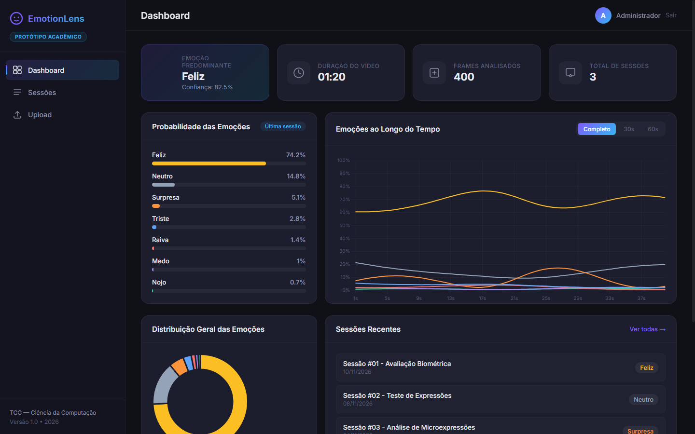
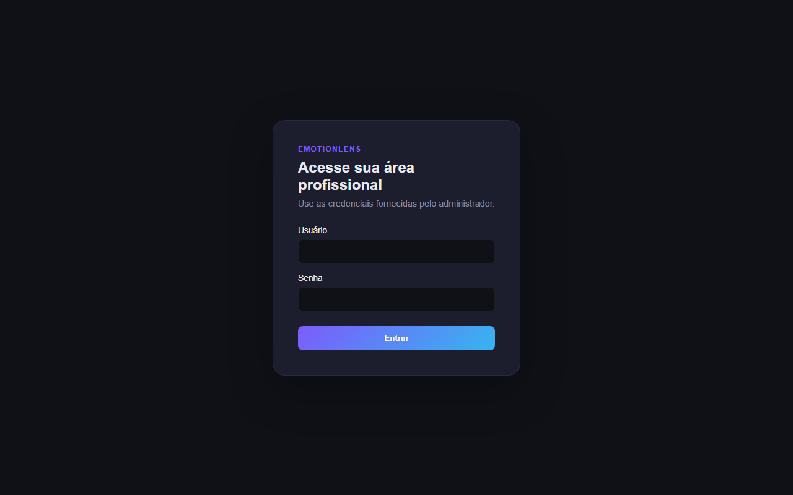
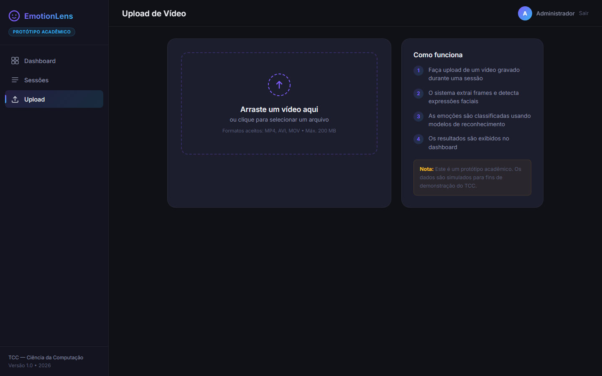
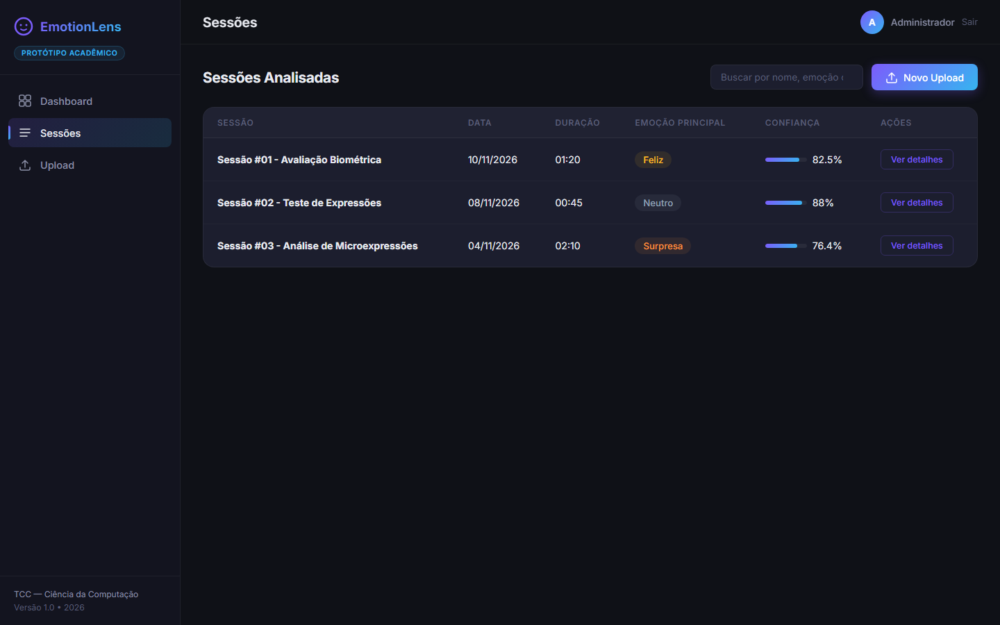
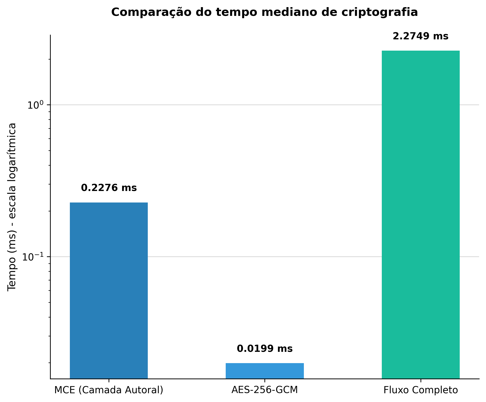
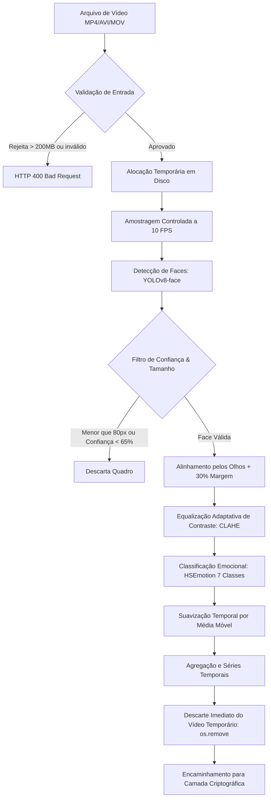
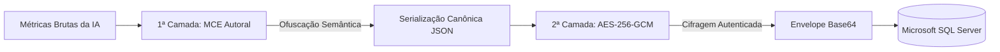

<p align="center">
  
  
  
  
  
  
</p>

<h1 align="center">EmotionLens (Cripto EmotionLens)</h1>

<p align="center">
  <strong>Plataforma Inteligente de Reconhecimento de Expressões Faciais e Análise Temporal de Vídeos com Criptografia em Duas Camadas e Proteção de Dados Biométricos Sensíveis.</strong>
</p>

<p align="center">
  <a href="#-interface-da-aplicação">Demonstração</a> •
  <a href="#-destaques-do-sistema">Recursos</a> •
  <a href="#-arquitetura-do-sistema">Arquitetura</a> •
  <a href="#-pipeline-de-visão-computacional">Pipeline de IA</a> •
  <a href="#-segurança-e-criptografia">Segurança</a> •
  <a href="#-como-executar">Instalação</a> •
  <a href="#-rotas-da-api">Endpoints</a>
</p>

---

## 📸 Interface da Aplicação

### 📊 Dashboard Principal & Telemetria Afetiva
> Visualização completa da sessão analisada: estatísticas agregadas, linha do tempo interativa segundo a segundo com filtro temporal e gráficos de dispersão das 7 expressões universais.

<p align="center">
  
</p>

<br>

### 🖥️ Módulos do Sistema

| 🔐 Autenticação Segura (JWT) | 📤 Upload & Processamento em Tempo Real |
|:---:|:---:|
|  |  |
| *Acesso restrito por credenciais com hashing Bcrypt e proteção contra ataques de força bruta.* | *Área de upload com validação de extensão, trava de 200 MB e etapas dinâmicas de análise.* |

| 📁 Histórico e Rastreabilidade de Sessões | 📈 Benchmark Real de Criptografia |
|:---:|:---:|
|  |  |
| *Listagem cronológica isolada por usuário autenticado com dados protegidos no SQL Server.* | *Tempo mediano de execução comprovado em 1.000 iterações (MCE: 0,22 ms \| Ciclo: 2,27 ms).* |

---

## ✨ Destaques do Sistema

- 🛡️ **Conformidade Estrita com a LGPD (Art. 5º e 6º):** Mapeamento facial tratado como dado biométrico sensível; descarte sumário do arquivo de vídeo após decodificação temporária pelo OpenCV (*Princípio da Minimização de Dados*).
- 🧠 **Pipeline Robusto de Visão Computacional:** Detecção facial com **YOLOv8-face**, alinhamento rotacional afim com **30% de margem contextual** e classificação temporal em 7 classes canônicas via **HSEmotion (EfficientNet-B2)**.
- 💡 **Normalização Adaptativa de Iluminação (CLAHE):** Correção de luminosidade no espaço de cores LAB antes da rede neural, garantindo alta acurácia mesmo em webcams de baixa qualidade ou ambientes com iluminação desfavorável.
- 🌊 **Filtro Anti-Flickering:** Suavização temporal por média móvel centrada (janela de 9 quadros), eliminando oscilações e ruídos rápidos causados por piscadas de olhos e movimentação da fala.
- 🔐 **Segurança em Profundidade (*Defense in Depth*):**
  - **1ª Camada (MCE Autoral):** Ofuscação semântica e equivalência bijetiva que desvincula os valores dos diagnósticos antes do salvamento.
  - **2ª Camada (AES-256-GCM):** Cifragem simétrica autenticada com vetor de inicialização (*nonce*) único de 12 bytes por sessão e tag AAD.
- 🗄️ **Persistência Corporativa em Microsoft SQL Server:** Modelo híbrido garantindo transações relacionais **ACID** para controle de usuários e integridade, persistindo o payload cifrado em coluna otimizada via driver nativo ODBC.

---

## 🏗️ Arquitetura do Sistema

O sistema é construído sobre uma arquitetura desacoplada em camadas limpas (*Clean Layered Architecture*):

```
TC/
├── backend/                  # API Web RESTful (FastAPI)
│   ├── app/
│   │   ├── rotas/            # Endpoints REST, validação de entrada e autenticação
│   │   ├── servicos/         # Orquestração de negócio e pipeline de análise
│   │   ├── dominio/          # Entidades puras (Usuario, Sessao, Emocao, Midia)
│   │   ├── esquemas/         # Contratos de serialização Pydantic (JSON)
│   │   ├── persistencia/     # Repositórios e conexão ODBC nativa com SQL Server
│   │   ├── ia/               # YOLOv8-face, HSEmotion, CLAHE, alinhamento e agregação
│   │   └── nucleo/           # Configurações, segurança (MCE + AES) e logs estruturados
│   ├── database/             # Scripts DDL, tabelas, índices e constraints SQL
│   └── testar_desempenho_cripto.py # Script de benchmarking automatizado
│
└── frontend/                 # Aplicação SPA Reativa (React 18 + Vite)
    ├── src/
    │   ├── components/       # Componentes modulares (Upload, Gráficos Chart.js, UI)
    │   ├── context/          # Provedores de estado global (AuthContext, SessionsContext)
    │   ├── pages/            # Páginas da aplicação (Dashboard, Upload, Sessions, Login)
    │   ├── routes/           # Rotas protegidas com controle de sessão
    │   └── services/         # Cliente HTTP configurado via Axios
    └── vite.config.js        # Configuração do bundler Vite
```

---

## 🔬 Pipeline de Visão Computacional



---

## 🔒 Segurança e Criptografia em Duas Camadas

Os dados de expressões faciais extraídos constituem dados biométricos sensíveis protegidos pela LGPD. O sistema aplica o princípio de **Defesa em Profundidade**:



### Resultados de Desempenho (1.000 iterações em carga real de 1 minuto / 300 quadros)

| Operação | Média (ms) | Mediana (ms) | Mínimo (ms) | Máximo (ms) |
|---|---|---|---|---|
| **MCE (Camada Autoral)** | 0,2340 | **0,2276** | 0,2263 | 0,4058 |
| **AES-256-GCM Isolado** | 0,0334 | **0,0199** | 0,0196 | 13,2563 |
| **Ciclo Completo (MCE + JSON + AES + Base64)** | 2,3487 | **2,2749** | 2,2189 | 4,1070 |

> *A camada de segurança completa consome apenas **2,27 ms**, garantindo proteção integral sem impacto perceptível na experiência do usuário.*

---

## 🚀 Como Executar

### Pré-requisitos
- **Python 3.10 ou 3.11** (64 bits)
- **Node.js 18+** e **npm**
- **Microsoft SQL Server 2017+** com **ODBC Driver 17 ou 18**

---

### 1. Banco de Dados (SQL Server)
Execute os scripts disponíveis na pasta `backend/database/`:
```sql
1. create_database.sql   -- Criação do banco EmotionLensDB
2. create_tables.sql     -- Tabelas de usuários e sessões
3. constraints.sql       -- Regras de integridade referencial
4. indexes.sql           -- Índices de consulta otimizados
```

---

### 2. Backend (FastAPI)
```bash
cd backend

# Criar e ativar o ambiente virtual (Windows PowerShell)
python -m venv .venv
.\.venv\Scripts\Activate.ps1

# Instalar dependências
pip install --upgrade pip
pip install -r requirements.txt

# Configurar variáveis de ambiente
cp .env.example .env
# Ajuste as credenciais do banco e chaves secretas no arquivo .env

# Criar o usuário administrador inicial
python scripts/criar_usuario.py admin "Administrador" --senha "SenhaForteSegura@2026"

# Iniciar o servidor da API
uvicorn app.main:app --reload --host 0.0.0.0 --port 8000
```
> API online em `http://localhost:8000` • Documentação Swagger em `http://localhost:8000/docs`

---

### 3. Frontend (React + Vite)
```bash
cd frontend

# Instalar dependências
npm install

# Configurar variáveis de ambiente
cp .env.example .env

# Iniciar em modo de desenvolvimento
npm run dev
```
> Acesse o dashboard no navegador: **`http://localhost:5173`**

---

## 🌐 Rotas da API

| Método | Rota | Autenticação | Descrição |
|:---:|---|:---:|---|
| `POST` | `/auth/login` | Pública | Autenticação OAuth2 Password Flow e emissão de JWT |
| `GET` | `/auth/me` | Bearer Token | Dados do perfil do usuário autenticado |
| `POST` | `/sessions/upload` | Bearer Token | Upload de vídeo e processamento completo com IA |
| `GET` | `/sessions` | Bearer Token | Histórico de sessões do usuário |
| `GET` | `/sessions/{id}` | Bearer Token | Detalhes e séries temporais de uma sessão específica |
| `GET` | `/health` | Pública | Healthcheck da API e do banco de dados |

---

## ⚙️ Variáveis de Ambiente

### `backend/.env`
| Variável | Descrição | Padrão |
|---|---|---|
| `EMOTIONLENS_ORIGENS_CORS` | Origens autorizadas para CORS (JSON) | `["http://localhost:5173"]` |
| `EMOTIONLENS_TAMANHO_MAXIMO_UPLOAD_BYTES` | Trava de upload (em bytes) | `209715200` (200 MB) |
| `EMOTIONLENS_DISPOSITIVO` | Dispositivo PyTorch (`auto`/`cuda`/`cpu`) | `auto` |
| `EMOTIONLENS_FPS_ALVO` | Amostragem de quadros por segundo | `10.0` |
| `EMOTIONLENS_MAX_FRAMES_ANALISADOS` | Teto de quadros analisados por vídeo | `600` |
| `EMOTIONLENS_JANELA_SUAVIZACAO` | Janela temporal da média móvel anti-flickering | `9` |
| `EMOTIONLENS_CHAVE_CRIPTOGRAFIA` | Chave de 32 bytes para o AES-256-GCM | *Segredo* |
| `EMOTIONLENS_CHAVE_JWT` | Chave de assinatura dos tokens JWT | *Segredo* |
| `EMOTIONLENS_DB_SERVIDOR` / `DB_NOME` | Conexão com Microsoft SQL Server | `localhost` / `EmotionLensDB` |

### `frontend/.env`
| Variável | Descrição | Exemplo |
|---|---|---|
| `VITE_API_URL` | URL base da API FastAPI | `http://localhost:8000` |

---

## 🎓 Finalidade Acadêmica

Trabalho de Conclusão de Curso (TCC) desenvolvido para o curso de **Bacharelado em Ciência da Computação**.  
O projeto possui caráter estritamente acadêmico e de pesquisa nas áreas de **Engenharia de Software, Visão Computacional e Segurança da Informação**.
